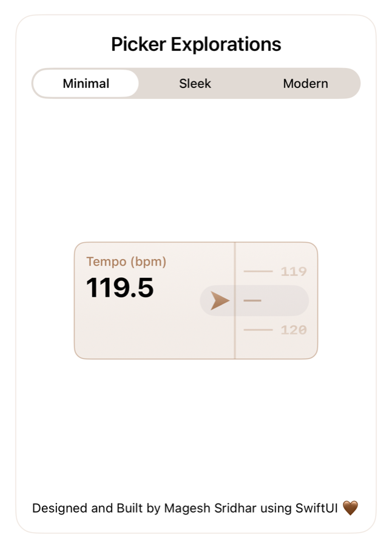
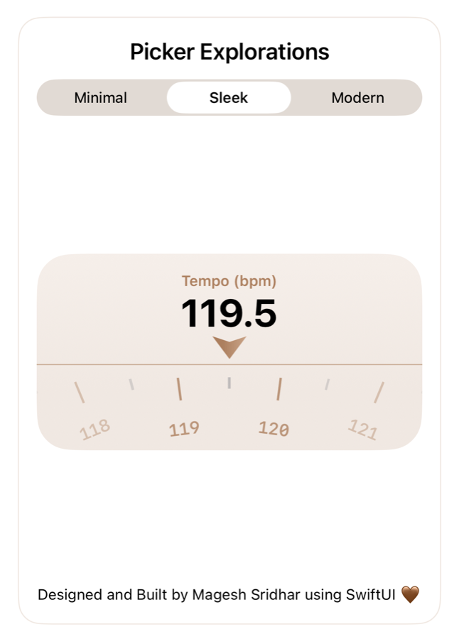
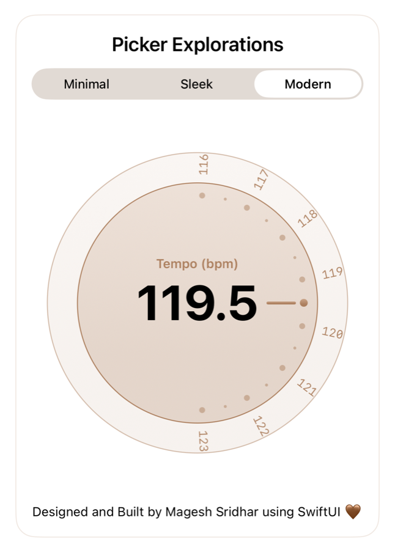

# Picker Explorations
Three takes on a tempo (bpm) picker, built from scratch in SwiftUI. Each one sets the same value, from 60 to 200 bpm in half steps, so you can switch between them and compare how each one feels.

  
  
  

### The designs
- **Minimal:** a wheel picker styled as a vertical ruler. Whole numbers get a long tick and a label, half steps get a short tick, and an arrow marks the selected value.
- **Sleek:** a horizontal ruler that snaps to each tick. Ticks near the selection fan out like a dial and fade with distance, and the value rolls with a numeric text transition.
- **Modern:** a semi-circular dial you drag up and down. The marks rotate around the ring, the left half fades out, and the dial springs to the nearest half step when you let go. A light haptic plays as you pass each value.

### It's all in the details:
- All three pickers share a single tempo model, so the value carries over when you switch styles.
- Sleek pads the ends of its ruler so the first and last ticks can still reach the center arrow.
- Modern measures each drag from where it started, so the dial never jumps under your finger.
- The layout fills the screen on iPhone and stays a fixed card on iPad.

### Tools and Frameworks used:
- SwiftUI
- Scroll position and view-aligned scroll target behavior
- Custom Shapes by drawing paths
- Drag gestures with spring snapping
- Content transitions for numeric text
- UIKit haptic feedback

### Requirements
- iOS 18.5 or later
- Xcode 16.4 or later
